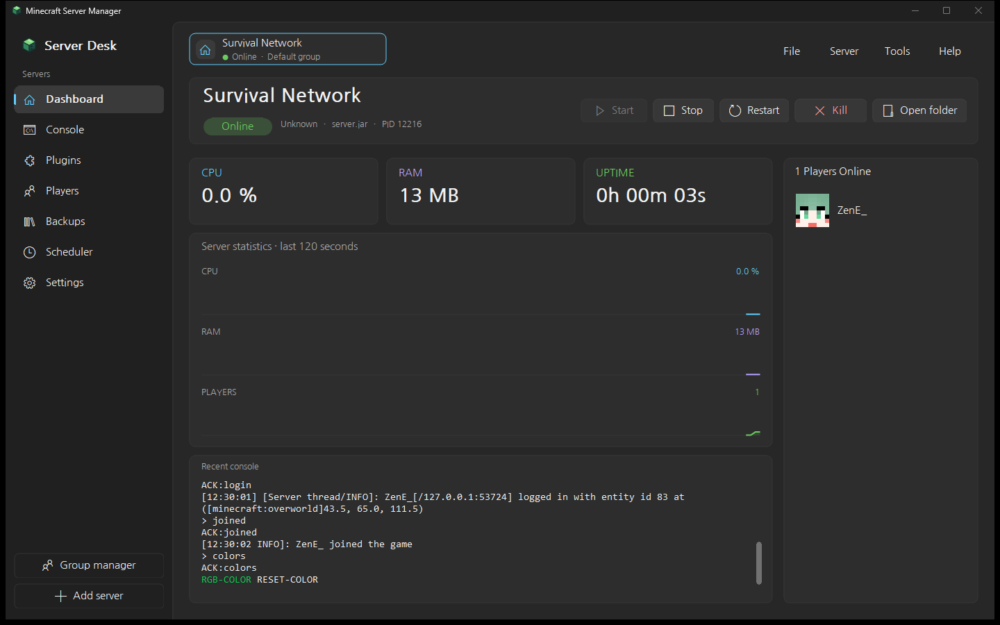
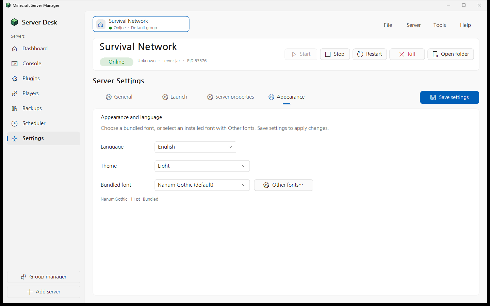

# Server Desk

A native Windows manager for Minecraft servers, written in C++20 on plain Win32.
It runs Java servers (JAR, Java argument files), BAT scripts and native EXE servers, and gives each
profile its own console, player list, plugins, backups and scheduled tasks.



- Windows 11–style interface with dark, light and system themes, scaled for 100–200% display settings
- Korean and English UI with bundled Nanum Gothic and Noto Sans KR fonts (no font installation needed)
- No runtime to install: a single static executable plus its `assets/fonts` folder

## Features

**Servers and groups**
- Multiple server profiles, each with its own process, console and player list
- Group start/stop, group restart and group-wide commands from the Group manager
- Graceful stop per distribution: `stop` (Java servers), `shutdown` (Velocity), `end` (BungeeCord / Waterfall)
- Detects Vanilla, CraftBukkit, Spigot, Paper, Purpur, Velocity, BungeeCord and Waterfall from the JAR
- Auto start when the app opens and automatic recovery after a crash (with delay and retry limit)
- On Windows shutdown, running servers are stopped gracefully so worlds are saved

**Console and players**
- ANSI 16/256/RGB colors and Minecraft `§` / `§x` / `§#RRGGBB` colors, including codes split across reads
- Command history (↑/↓), search (Ctrl+F), log export, line wrap and auto scroll
- Online players with faces from mc-heads.net; kick, ban, op, deop, whitelist and unban with confirmation
- CPU and memory per server (all processes started by the server, including launcher scripts)

**Plugins, backups and scheduling**
- Plugin list with real names and versions from `plugin.yml`, `paper-plugin.yml`, `bungee.yml` and
  `velocity-plugin.json`; drag and drop JARs to import, enable/disable, replace or remove
- ZIP or folder backups outside the server folder, retention count and restore
  (the current folder is kept as `.before-restore`); a running server is stopped, backed up and restarted
- Scheduler: send a command, restart or back up on an interval or daily at a set time, with custom presets

**Launch modes**

| Mode | Use for |
|---|---|
| JAR | Vanilla, Paper, Purpur, Fabric launcher, … (Java path, memory, JVM options, server arguments) |
| Java arguments / `@args` | Forge-style `@user_jvm_args.txt @libraries/.../win_args.txt` launches |
| BAT | Modpack start scripts (remove `pause` and restart loops from the script) |
| Native EXE | Bedrock and other servers that accept `stop` on standard input |

The install helper opens the official download pages and can run Fabric / Forge installer JARs into an
empty folder. *Find Java* searches `JAVA_HOME`, `PATH` and common JDK install folders.

**Web panel (optional)**

A small HTTP panel and JSON API, disabled by default, that listens on `127.0.0.1` only.
Accounts use 256-bit API keys with `viewer`, `operator` or `admin` roles. For remote access use an SSH
tunnel (`ssh -L 25560:127.0.0.1:25560 user@host`) or an HTTPS reverse proxy; plain HTTP is never exposed
on other interfaces. Endpoints include `GET /api/servers`, `GET /api/servers/{id}/log` and
`POST /api/servers/{id}/start|stop|restart|kill|command|backup`, plus task and account management.



## Getting started

1. Open **Settings → Launch**, choose Java and the server JAR (or drop them on the window), set the
   memory and choose **Save settings**.
2. Choose **Start** and wait for the `Done` message in the console.
3. Add more servers with **Add server**. The Minecraft EULA is accepted once per profile.
4. **Stop** sends the graceful stop command and waits for the world to save. **Kill** asks first and
   may lose unsaved data.

Give each server its own port before running several at once.

Settings are stored next to the executable in `wrapper.ini` (UTF-16, written atomically), together with
copied profile images in `profile-images/`, so the folder must be writable. The plugin metadata cache
lives in `%LOCALAPPDATA%\ServerDesk\plugin-cache` and can be deleted at any time.

## Building

Requirements: Windows 10/11 x64, CMake 3.31+, and a C++20 compiler. The project is developed with the
MinGW-w64 GCC 13 toolchain bundled with CLion; MSVC flags are present but not regularly tested.

```powershell
cmake -S . -B build -G Ninja -DCMAKE_BUILD_TYPE=Release
cmake --build build
ctest --test-dir build --output-on-failure
```

Helper scripts (they use CLion's bundled toolchain by default):

- `scripts\build.cmd` builds the `MinecraftServerWrapper` target into `cmake-build-mcss`.
- `scripts\package.cmd` builds Release and creates `dist\ServerDesk-<version>-win64.zip`.

Ship `MinecraftServerWrapper.exe` together with the `assets\fonts` folder.

### Tests

- `ctest` runs `wrapper_core_tests` (settings, paths, colors, JAR metadata, localization, groups) and
  `wrapper_operations_tests` (launch commands, backups/restore, scheduling math, web panel auth).
- `tests\smoke.ps1`, `tests\operations-smoke.ps1` and `tests\ui-regressions.ps1` drive the real GUI
  against a mock server in temporary folders, for example:

  ```powershell
  powershell -NoProfile -ExecutionPolicy Bypass -File .\tests\smoke.ps1 -BuildDirectory .\cmake-build-mcss
  ```

  They never touch your configured servers.

## Project layout

| Path | Contents |
|---|---|
| `src/app` | The `App` class: window, pages, layout, drawing, settings, scheduler |
| `src/ui` | Shared UI pieces: themed message box, icons, inputs, rounded surfaces, DPI scaling |
| `src/core` | UI-independent logic (`wrapper_core` library): launch commands, colors, properties, JAR reader, localization |
| `src/server` | Server process, backups, web panel, player detection |
| `resources`, `assets` | Manifest, icon and bundled fonts |
| `tests` | Unit tests, mock server and GUI scripts |

## License

MIT — see [LICENSE](LICENSE). Bundled fonts (SIL Open Font License) and miniz (MIT) are listed in
[THIRD_PARTY.md](THIRD_PARTY.md).

Server Desk is not affiliated with Mojang or Microsoft. Minecraft is a trademark of Mojang Synergies AB.
